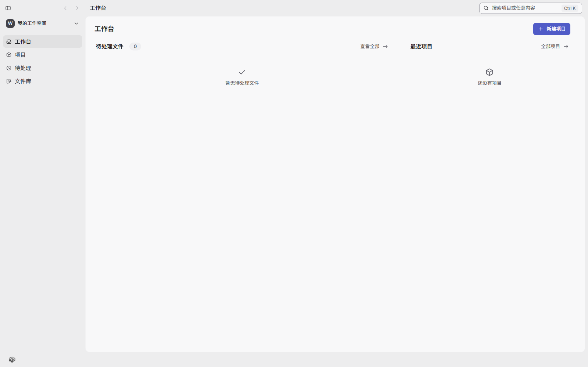
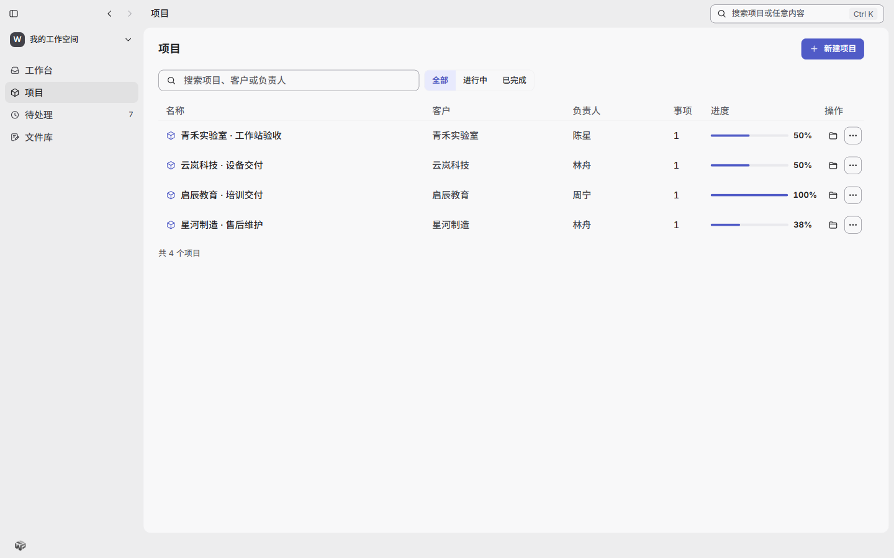
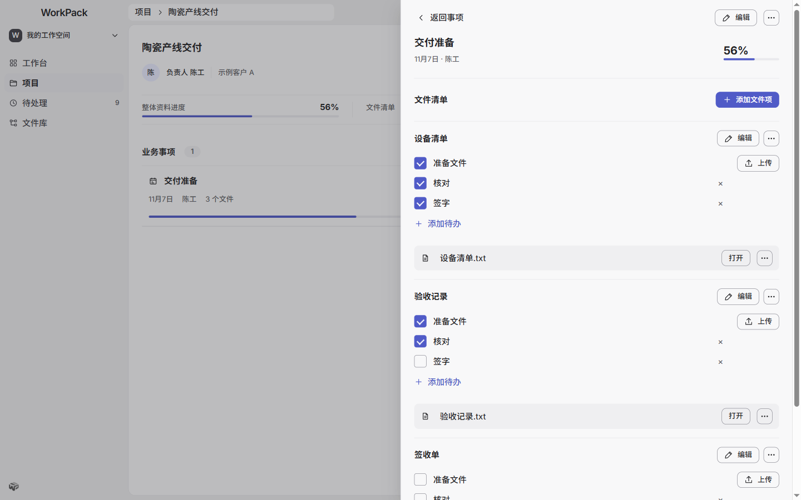
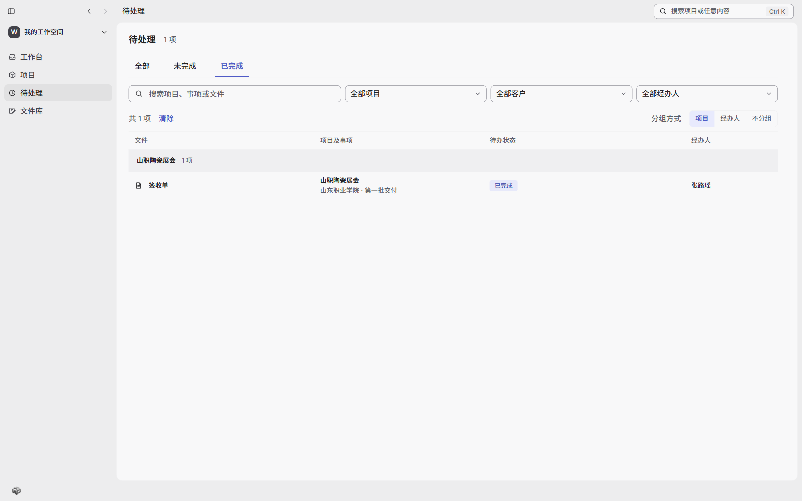
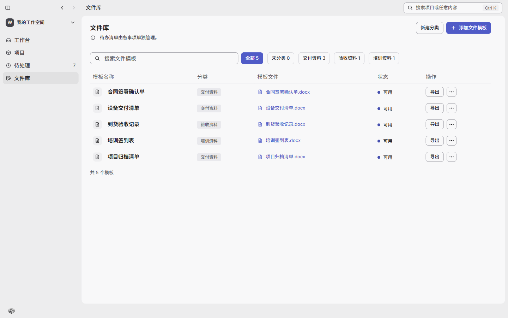

# WorkPack

<picture>
  <source media="(prefers-color-scheme: dark)" srcset="docs/assets/workpack-logo-on-light.png">
  
</picture>

**把项目资料整理清楚，让每份文件都有进度。**

WorkPack 是 Windows 本地项目资料管理工具。按项目组织事项，把文件准备、资料复核、签字确认和归档放进同一份清单，打开工作台就能看到还要跟进什么。

[下载 Windows x64 版](https://github.com/Vyenkor/WorkPack/releases/latest) · [更新日志](https://github.com/Vyenkor/WorkPack/releases) · [使用指南](docs/USAGE.md) · [开发指南](docs/DEVELOPMENT.md)



## 从项目到文件，逐项推进

- **项目**：集中查看客户、负责人、业务事项和资料进度，每个项目对应一个本地文件夹。
- **事项**：把设备交付、现场验收、培训等工作拆开管理，选择所需模板建立文件清单。
- **文件待办**：每份文件自带“准备文件”，可以继续添加复核、签字、归档等待办，完成后勾选。
- **待处理**：汇总各项目尚未完成的文件，按项目、客户、经办人筛选，也可按项目或经办人分组。
- **文件库**：按分类维护可复用模板，导入原件后，在创建事项时生成独立工作副本。

### 项目进展，一处查看

项目列表同时显示客户、负责人、事项数量和资料进度，进入项目即可继续处理。



### 打开事项，处理具体文件

在侧边抽屉中查看文件、上传附件和勾选待办，处理完即可回到原来的列表位置。



### 需要跟进的资料，集中处理

待处理页默认显示未完成文件，也能切换全部或已完成。筛选和分组会保留，下次打开继续使用。



### 常用模板，重复使用

把合同、交付清单、验收记录等整理进文件库，创建事项时勾选需要的文件。



以上均为应用实际运行截图，使用演示项目与临时文件；截图完成后已清理演示数据。

## 开始使用

1. 从 [Releases](https://github.com/Vyenkor/WorkPack/releases/latest) 下载并运行 `WorkPack-<版本>-Setup.exe`，选择安装位置。
2. 在文件库添加常用模板，按需导入原件、设置分类。
3. 新建项目，填写项目名称、客户和负责人。
4. 在项目中创建事项，选择模板，开始准备文件、添加待办并跟踪进度。

默认存储位置已配置，可以直接开始使用。需要调整目录时，打开工作空间菜单中的**设置 → 存储**。

## 数据保存在本机

项目文件、模板原件和工作空间数据库保存在电脑上，三个存储位置可以分别设置。项目记录与实际文件的删除规则、目录迁移和备份方式见[使用指南](docs/USAGE.md)。

## 开发与验证

使用 Node.js 26 和 npm，依赖由 `package-lock.json` 锁定。

```bash
npm ci
npm run dev
```

```bash
npm run typecheck
npm test
npm run test:e2e
npm run dist
```

构建、数据目录、实测截图复现及版本发布流程见[开发指南](docs/DEVELOPMENT.md)。界面规范见 [DESIGN.md](DESIGN.md)，协作约定见 [AGENT.md](AGENT.md)。产品范围及后续开发安排见[产品规划](Agent/Codex/产品规划/00_规划索引.md)。
